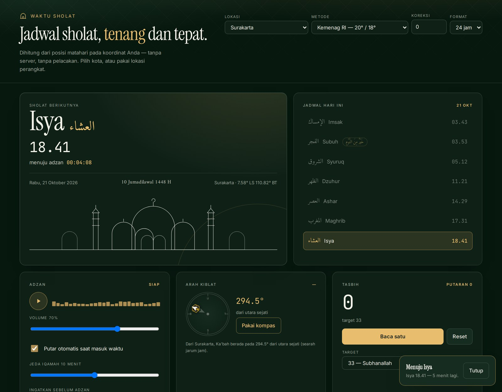

<div align="center">

# Waktu Sholat

**Jadwal sholat lima waktu yang dihitung dari posisi matahari, lengkap dengan pengingat adzan, arah kiblat, dan tasbih.**

[](https://atmajadesna.github.io/waktu-sholat/)


<a href="https://atmajadesna.github.io/waktu-sholat/"></a>

</div>

## Latar Belakang

Aplikasi jadwal sholat umumnya bergantung pada server: jadwal diambil dari API, sehingga
tidak dapat dibuka tanpa jaringan, dan sebagian meminta izin lokasi yang tidak jelas
penggunaannya. Aplikasi ini menghitung sendiri waktu sholat di perangkat, dari koordinat
dan tanggal — tanpa permintaan jaringan sama sekali.

## Poin Teknis

**Waktu sholat dihitung, bukan diambil.** Posisi matahari (deklinasi dan persamaan waktu)
dihitung dari Julian Day, lalu sudut waktu diturunkan untuk setiap waktu sholat:
`cos t = (−sin a − sin δ · sin φ) / (cos δ · cos φ)`. Ashar memakai sudut bayangan
`arccot(1 + tan|φ − δ|)`. Hasilnya dikonversi ke zona waktu kota.

**Hasilnya cocok dengan jadwal Kemenag.** Untuk Surakarta dengan metode Kemenag (20° / 18°),
seluruh waktu sama dengan keluaran API Aladhan bermetode sama, sampai ke menit — termasuk
Imsak, Syuruq, dan Ashar.

**Lafaz Subuh diperlakukan khusus.** Adzan Subuh menambahkan “ash-shalatu khairun minan-naum”
setelah “hayya ‘alal-falah”. Lafaz ini ditampilkan pada kartu utama ketika sholat berikutnya
adalah Subuh, ditandai pada baris Subuh di jadwal, dan dijelaskan pada kartu Catatan Subuh
beserta dalilnya (HR. Bukhari no. 615, Muslim no. 644).

**Arah kiblat memakai bearing great-circle.** `atan2(sin Δλ · cos φ₂, cos φ₁ · sin φ₂ −
sin φ₁ · cos φ₂ · cos Δλ)` terhadap Ka'bah (21,4225° LU 39,8262° BT), ditampilkan pada kompas
bersama jarak ke Ka'bah. Bila perangkat memiliki sensor arah, jarum mengikuti rotasi perangkat.

**Suara adzan disimpan lokal.** Berkas MP3 42 detik dimuat dari direktori yang sama, diputar
saat waktu sholat tiba (dengan izin pengguna), lalu diikuti hitung mundur iqamah.

## Fitur

- Jadwal Imsak, Subuh, Syuruq, Dzuhur, Ashar, Maghrib, dan Isya untuk 18 kota Indonesia
- Metode perhitungan: Kemenag RI, Muslim World League, ISNA, Umm al-Qura, Egyptian
- Koreksi menit manual, format 12/24 jam, dan lokasi perangkat bila diizinkan
- Hitung mundur menuju adzan, diperbarui setiap detik
- Adzan otomatis, pengingat sebelum adzan, notifikasi peramban, hitung mundur iqamah
- Kompas kiblat dengan penanda Ka'bah, derajat bearing, jarak, dan arah mata angin
- Tasbih digital dengan target 33 / 99 / 100 dan penghitung putaran
- Catatan sholat harian dengan rangkaian hari lengkap, serta jadwal sebulan penuh
- Tanggal Hijriah melalui kalender `islamic-umalqura` bawaan peramban
- Seluruh pengaturan tersimpan di `localStorage`; tidak ada data yang dikirim keluar

## Menjalankan

```bash
python3 -m http.server 8000
```

Tidak diperlukan dependensi maupun proses build. Berkas `index.html` juga dapat dibuka
langsung, tetapi pemutaran audio dan geolokasi lebih stabil melalui server lokal.

## Struktur Berkas

```
index.html    struktur halaman
app.js        perhitungan waktu, kiblat, audio, dan penyimpanan
styles.css    tata letak dan komponen antarmuka
tokens.css    warna, ukuran teks, dan spasi sebagai variabel
audio/        rekaman adzan (MP3)
```

## Batas yang Perlu Diketahui

- Pengingat hanya berjalan selama halaman terbuka; tidak ada notifikasi latar belakang
  karena tidak ada server maupun service worker.
- Selisih 1–2 menit terhadap jadwal resmi dapat terjadi karena perbedaan metode, ketinggian
  tempat, dan pembulatan. Jadwal resmi Kemenag tetap menjadi acuan.
- Kompas perangkat hanya bekerja pada perangkat bersensor dan memerlukan izin; tanpa sensor,
  arah tetap ditampilkan sebagai derajat dari utara sejati.

## Kredit

Rekaman adzan: **“Adhan” oleh Aishatu98**, Wikimedia Commons, lisensi
[CC0 1.0](https://creativecommons.org/publicdomain/zero/1.0/deed.en) (domain publik).
Berkas dikonversi ke MP3 dengan penyelarasan kenyaringan, tanpa perubahan isi.

Dibangun menggunakan JavaScript, CSS, dan HTML, tanpa kerangka kerja.
